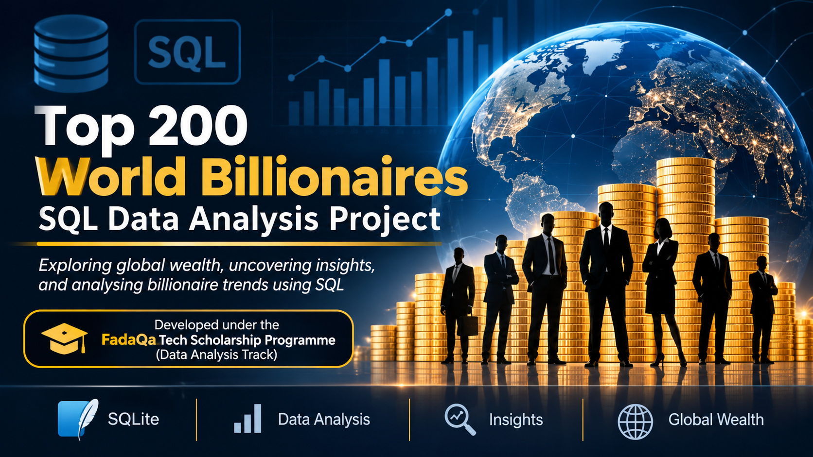

# GLOBAL BILLIONAIRE WEALTH ANALYSIS

### SQL Data Analysis Project

**FadaQa Tech Scholarship Programme**

##  Project Overview

This project focuses on analysing the world's top 200 billionaires using SQL (SQLite) to uncover meaningful insights into global wealth distribution, individual net worth, age demographics, countries, and industries.

The analysis explores the financial profiles of the world's wealthiest individuals through SQL queries, answering key business questions and identifying patterns in billionaire wealth distribution.

This project was completed as part of the **FadaQa Tech Scholarship Programme (Data Analysis Track)** to demonstrate practical SQL skills, data exploration, data querying, and analytical thinking.

##  Project Objectives

The main objectives of this project are to:

1. Identify and rank the top 20 richest billionaires in the dataset.
2. Examine the age distribution of the world's top 200 billionaires.
3. Analyse billionaire representation across different countries.
4. Identify industries with the highest number of billionaires.
5. Determine the countries with the highest combined billionaire wealth.
6. Calculate average and total net worth across different categories.
7. Explore wealth distribution among billionaires below and above specific age groups.
8. Use SQL queries to answer business questions and generate meaningful data-driven insights.

9. ## 📂 Dataset Description

The dataset used for this project contains information on the **Top 200 Richest People in the World**.

It consists of 200 records and 7 columns, providing details about individual billionaires, their rankings, net worth, countries, ages, and industries.

### Dataset Features

| Column | Description |
|---|---|
| serial_number | Unique record identifier |
| rank | Billionaire's wealth ranking |
| name | Full name of the billionaire |
| age | Age of the individual |
| country | Country associated with the billionaire |
| networth_billion_US_dollars | Net worth in billions of US dollars |
| industry | Primary industry associated with the billionaire |

### Dataset Size
- **Total Records:** 200
- **Total Columns:** 7
- **Missing Values:** None detected

  
  ## 🛠️ Tools & Technologies Used

### 💻 Tools
- SQLite
- Microsoft Excel

### ⚙️ Technologies

### 📊 SQL Skills & Techniques
- Aggregate Functions: `COUNT()`, `SUM()`, `AVG()`, `MAX()`, `MIN()`
- Clauses: `SELECT`, `WHERE`, `GROUP BY`, `ORDER BY`, `HAVING`
- Other Techniques: `DISTINCT`, Subqueries and Conditional Filtering

  ## 📊 SQL Analysis & Business Questions

The project involved analysing the Top 200 Richest People in the World dataset using SQL to answer 24 business questions and uncover insights into global wealth distribution.

### 🔍 Key Areas of Analysis

- **Wealth Analysis:** Top 20 richest billionaires, highest and lowest net worth, average wealth and wealth distribution.
- **Age Analysis:** Youngest billionaires, average age, billionaires below 50 and above 70.
- **Country Analysis:** Billionaire population, combined wealth, average net worth and country comparisons.
- **Industry Analysis:** Most represented industries, average wealth and total industry contributions.
- **Statistical Analysis:** Wealth comparisons, percentages, rankings and aggregate calculations.

### 🧮 SQL Techniques Applied

`SELECT` · `WHERE` · `GROUP BY` · `ORDER BY` · `HAVING` · `DISTINCT` · `COUNT()` · `SUM()` · `AVG()` · `MAX()` · `MIN()` · Subqueries

## 📈 Key Findings & Insights

The SQL analysis revealed the following insights from the dataset:

- **Total Billionaire Wealth:** $6,368.5 billion.
- **Average Net Worth:** $31.84 billion.
- **Average Age:** 69.38 years.
- **Top 10 Billionaires:** Combined net worth of $1,552 billion.
- **Leading Country:** United States, with 79 billionaires.
- **Leading Industry:** Technology, with 40 billionaires.
- **Young Billionaires:** 16 individuals are below the age of 50, representing 8% of the dataset.
- **Highest Individual Net Worth:** $233 billion.
- **Lowest Individual Net Worth:** $10.7 billion.

### 💡 Key Insight

The United States has the highest representation in the dataset, while the technology industry has the largest number of billionaires. The wealth distribution also shows a significant concentration of wealth among the richest individuals.

*Note: These findings reflect the supplied dataset and not necessarily current billionaire rankings.*

### 🎯 Skills Demonstrated
- Data Exploration
- Data Aggregation
- Data Filtering
- Data Analysis
- Data Interpretation

  ## 💡 Conclusion

This project provided an opportunity to apply SQL skills in analysing real-world-style billionaire data and extracting meaningful insights into global wealth distribution.

Through 24 business questions, I explored billionaire rankings, net worth, age demographics, countries, and industries using SQL queries and analytical techniques.

The project strengthened my practical understanding of SQL, data exploration, aggregation, and data-driven decision-making.

